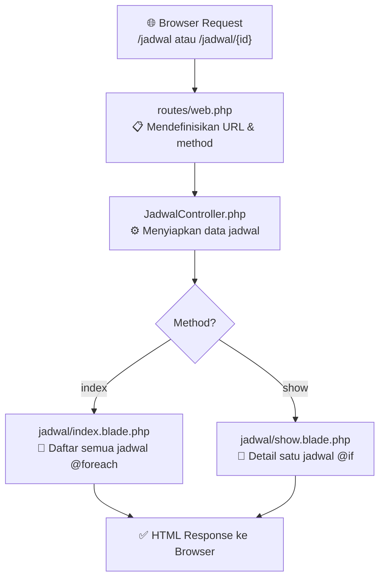
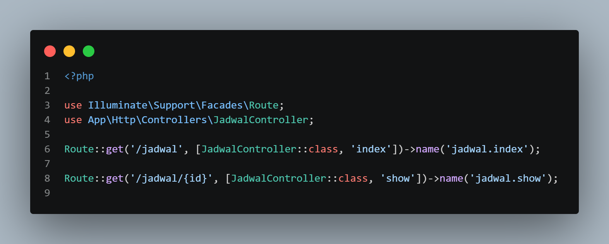
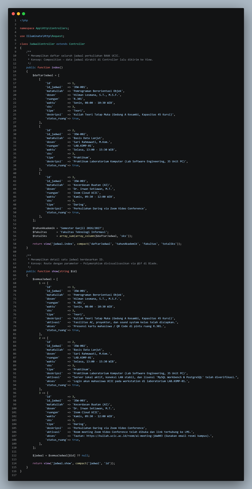
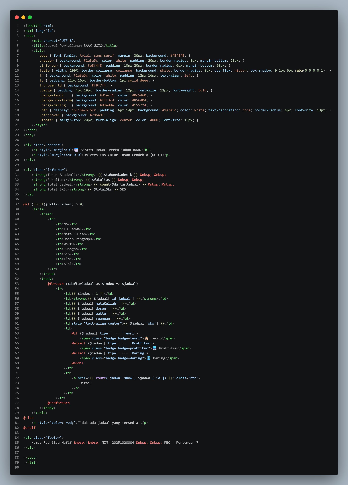
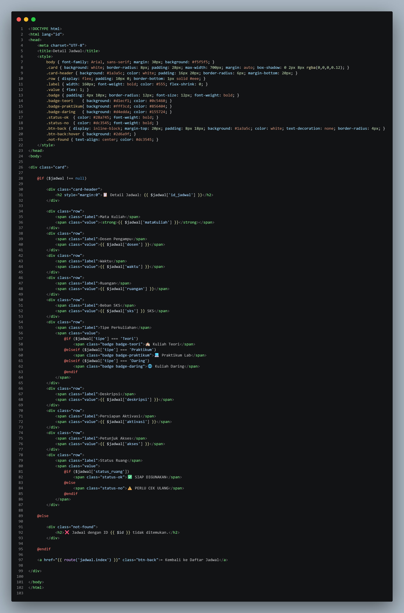
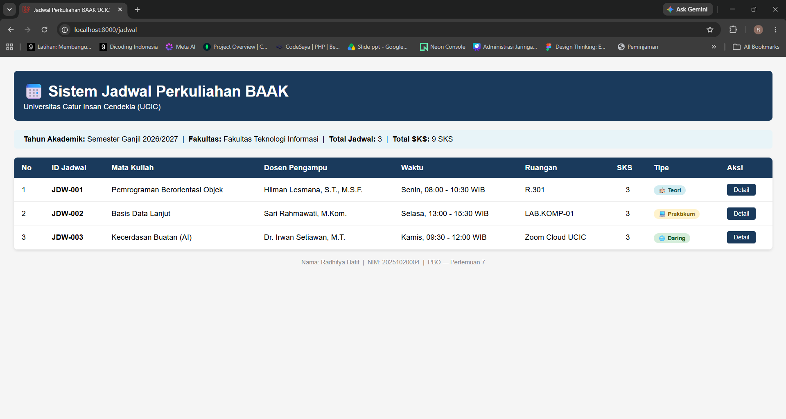
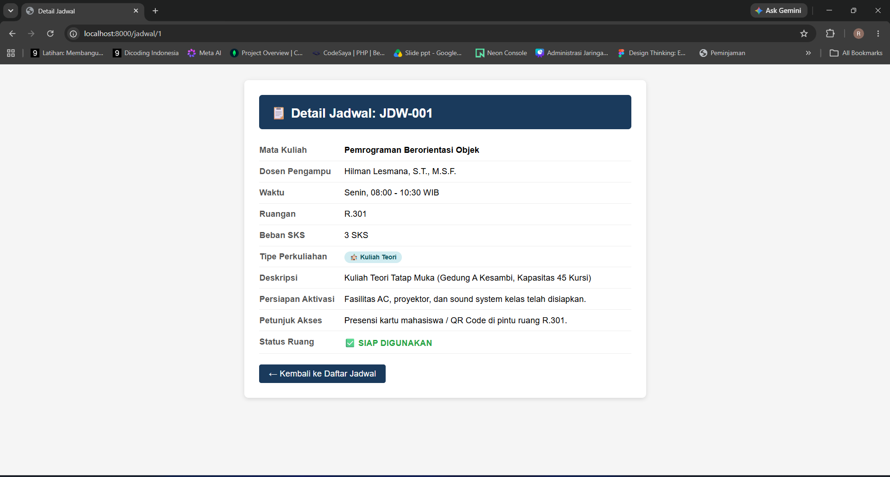

# LAPORAN TUGAS PEMROGRAMAN BERORIENTASI OBJEK — PERTEMUAN 7: LARAVEL MVC
**Mata Kuliah:** Pemrograman Berorientasi Objek (TI033015) — Pertemuan 7  
**Dosen Pengampu:** Hilman Lesmana, S.T., M.S.F.  
**Program Studi:** S1 Teknik Informatika — Universitas Catur Insan Cendekia (UCIC)  

---

## 👨‍🎓 Identitas Mahasiswa
* **Nama Lengkap :** Radhitya Hafif  
* **NIM          :** 20251020004  
* **Kelas / Smt  :** TI Semester 3  
* **Project Laravel :** [`JadwalkuApp/`](.)  
* **Topik Domain :** BAAK — Sistem Pengelolaan Jadwal Perkuliahan Mahasiswa  

---

## 1. Latar Belakang Domain & Masalah

Pada tugas Pertemuan 5, sistem jadwal perkuliahan BAAK telah dimodelkan menggunakan **Pure PHP** dengan prinsip Advanced OOP (*Interface, Abstraction, Inheritance, Overriding, Polymorphism, dan Composition*). Namun pendekatan tersebut hanya menghasilkan output berupa teks CLI, belum dapat diakses melalui browser sebagai aplikasi web.

Pada Pertemuan 7 ini, **domain yang sama** (Sistem Pengelolaan Jadwal Perkuliahan BAAK UCIC) diimplementasikan kembali menggunakan framework **Laravel** dengan pola arsitektur **MVC (Model-View-Controller)**:

1. **Kuliah Teori (Tatap Muka):** Divisualisasikan dengan badge tipe dan data ruang fisik melalui Blade template.
2. **Praktikum Laboratorium:** Ditampilkan dengan informasi lab dan status ketersediaan ruang via `@if` di Blade.
3. **Kuliah Daring (Synchronous):** Ditampilkan dengan data platform dan link meeting melalui route berparameter.

Perpindahan dari PHP native ke Laravel membuktikan bahwa desain OOP yang baik (terutama *Separation of Concerns*) adalah fondasi langsung dari arsitektur MVC: **Controller ≈ Logic Class**, **View (Blade) ≈ Presentasi**, **Route ≈ Entry Point**.

---

## 2. Arsitektur MVC & Alur Route → Controller → Blade

### Diagram Alur Request



### Pemetaan Konsep OOP M5 → Laravel P7

```mermaid
classDiagram
    class `routes/web.php` {
        +GET /jadwal → index()
        +GET /jadwal/{id} → show()
    }

    class JadwalController {
        +index() view jadwal.index
        +show(id) view jadwal.show
        -$daftarJadwal array
        -$semuaJadwal array
    }

    class `jadwal/index.blade.php` {
        +@foreach $daftarJadwal
        +@if tipe === Teori
        +@elseif tipe === Praktikum
        +@elseif tipe === Daring
        +route jadwal.show id
    }

    class `jadwal/show.blade.php` {
        +@if $jadwal !== null
        +@if tipe === Teori
        +@if status_ruang
        +@else Tidak Ditemukan
        +route jadwal.index
    }

    `routes/web.php` --> JadwalController : mengarahkan request
    JadwalController --> `jadwal/index.blade.php` : compact daftarJadwal
    JadwalController --> `jadwal/show.blade.php` : compact jadwal id
```

---

## 3. Struktur File Project

```
JadwalkuApp/
├── routes/
│   └── web.php                          ← Definisi route /jadwal dan /jadwal/{id}
├── app/
│   └── Http/
│       └── Controllers/
│           └── JadwalController.php     ← Controller utama (index & show)
└── resources/
    └── views/
        └── jadwal/
            ├── index.blade.php          ← Tampilan daftar jadwal (@foreach, @if)
            └── show.blade.php           ← Tampilan detail jadwal (@if, parameter id)
```

---

## 4. Penjelasan Implementasi Komponen Laravel

### A. Route (`routes/web.php`) — Entry Point Aplikasi

Route mendefinisikan dua URL yang bisa diakses browser dan meneruskannya ke method yang sesuai di Controller. Route `/jadwal/{id}` menggunakan **parameter dinamis** sehingga setiap jadwal memiliki URL unik berdasarkan ID-nya.

<p align="center">
  
</p>

| Method | URL | Controller Method | Nama Route |
|--------|-----|-------------------|------------|
| GET | `/jadwal` | `JadwalController@index` | `jadwal.index` |
| GET | `/jadwal/{id}` | `JadwalController@show` | `jadwal.show` |

---

### B. Controller (`JadwalController.php`) — Penyedia Data

Controller berperan sebagai pengganti class `PengelolaJadwalBAAK` dari M5. Method `index()` menyiapkan seluruh data jadwal (sebagai *array of arrays*) dan mengirimkannya ke view menggunakan `compact()`. Method `show()` menerima parameter `$id` dari route, mencari data jadwal yang cocok, lalu mengirimnya ke view detail.

> **Penting:** Parameter `$id` dari route bertipe `string`, sehingga dilakukan casting `(int) $id` agar cocok dengan key array integer di `$semuaJadwal`.

<p align="center">
  
</p>

---

### C. Blade View Index (`jadwal/index.blade.php`) — Daftar Jadwal

View index menampilkan seluruh jadwal dalam bentuk tabel menggunakan **`@foreach`** untuk iterasi data dan **`@if / @elseif`** untuk membedakan tampilan badge tipe perkuliahan (Teori / Praktikum / Daring). Ini merupakan representasi visual dari **Polymorphism** yang di M5 dilakukan melalui `deskripsiFormat()`.

<p align="center">
  
</p>

---

### D. Blade View Show (`jadwal/show.blade.php`) — Detail Jadwal

View show menerima variabel `$jadwal` dari Controller. Menggunakan **`@if ($jadwal !== null)`** untuk memastikan data ditemukan sebelum ditampilkan, dan **`@if / @elseif`** untuk menampilkan badge tipe serta status kesiapan ruang. Jika ID tidak ditemukan, menampilkan pesan *"Jadwal tidak ditemukan"*.

<p align="center">
  
</p>

---

## 5. Bukti Hasil Eksekusi Program (Screenshot Browser)

Server dijalankan melalui terminal dengan perintah:
```bash
cd JadwalkuApp
php artisan serve
```
Kemudian diakses di browser: `http://127.0.0.1:8000/jadwal`

### Tangkapan Layar Halaman `/jadwal` (Daftar Jadwal)

<p align="center">
  
</p>

### Tangkapan Layar Halaman `/jadwal/{id}` (Detail Jadwal)

<p align="center">
  
</p>

---

## 6. Perbandingan: PHP Native (M5) vs Laravel (P7)

| Aspek | PHP Native — M5 | Laravel — P7 |
|---|---|---|
| **Entry Point** | Eksekusi langsung file `.php` | `routes/web.php` |
| **Logic & Data** | Class `PengelolaJadwalBAAK` | `JadwalController` |
| **Tampilan** | `echo` di terminal (CLI) | Blade template di browser |
| **Polymorphism** | Method `deskripsiFormat()` override | `@if / @elseif` di Blade |
| **Composition** | Array `$daftarJadwal` di class | Array `$daftarJadwal` di Controller |
| **Parameter** | Argumen fungsi PHP | Route parameter `{id}` |
| **Iterasi** | `foreach` PHP | `@foreach` Blade |
| **Kondisi** | `if/else` PHP | `@if / @else` Blade |
| **Output** | Terminal CLI | HTML di Browser |

---

## 7. Cara Menjalankan Project

```bash
# 1. Masuk ke folder project
cd JadwalkuApp

# 2. Install dependency (jika belum)
composer install

# 3. Salin file environment
cp .env.example .env

# 4. Generate application key
php artisan key:generate

# 5. Jalankan server development
php artisan serve
```

Buka browser dan akses:
- **Daftar Jadwal:** `http://127.0.0.1:8000/jadwal`
- **Detail Jadwal 1:** `http://127.0.0.1:8000/jadwal/1`
- **Detail Jadwal 2:** `http://127.0.0.1:8000/jadwal/2`
- **Detail Jadwal 3:** `http://127.0.0.1:8000/jadwal/3`

---

## 8. Refleksi Pembelajaran (RPS Pertemuan 7)

1. **OOP sebagai Fondasi MVC:**  
   Pelajaran terpenting dari pertemuan ini adalah memahami bahwa pola MVC Laravel bukan konsep baru, melainkan formalisasi dari prinsip OOP yang sudah dipelajari. Controller menjalankan peran yang sama dengan class pengelola di M5, hanya saja kini terhubung ke HTTP request alih-alih dipanggil langsung dari skrip.

2. **Route Berparameter sebagai Pengganti Argumen Fungsi:**  
   Di M5, data jadwal spesifik diteruskan melalui argumen fungsi PHP. Di Laravel, hal yang sama dicapai melalui route parameter `{id}` yang otomatis diteruskan ke method Controller — ini merupakan implementasi *Dependency Injection* paling dasar di framework.

3. **Blade `@if` & `@foreach` sebagai Polymorphism Visual:**  
   Jika di M5 polymorphism bekerja dengan *dynamic dispatch* method `deskripsiFormat()` tanpa percabangan, di Blade percabangan `@if` justru digunakan secara eksplisit untuk keperluan **presentasi visual** (badge warna berbeda per tipe). Keduanya memiliki tujuan yang sama — menampilkan data yang berbeda sesuai tipenya — namun melalui mekanisme yang sesuai dengan konteks masing-masing (runtime OOP vs template rendering).
